<div align="center">
  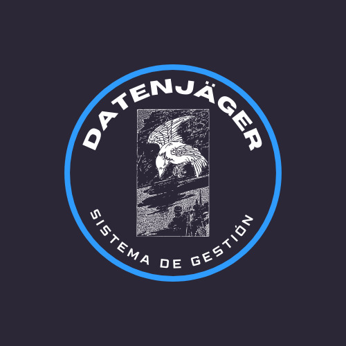

  # DatenJäger

  **Gestión documental cifrada para pequeñas y medianas empresas del sector minero**

  [](https://www.electronjs.org/)
  [](https://react.dev/)
  [](https://tailwindcss.com/)
  [](https://fastapi.tiangolo.com/)
  [](https://www.python.org/)
  [](https://www.sqlite.org/)
  

  Universidad de Cundinamarca · Seccional Ubaté · Ingeniería de Sistemas y Computación
</div>

DatenJäger permite registrar titulares y empresas, cifrar y consultar documentos PDF, auditar operaciones y generar reportes. La aplicación actual usa **Electron + React + Tailwind CSS** para la interfaz y **Python + FastAPI + SQLite** para el servicio local. La antigua interfaz CustomTkinter sigue en el repositorio como transición, pero no es el frontend documentado aquí.

> **Estado de publicación:** el código de la rama `v2.1` y su [PR abierto](https://github.com/RavenCore99/DatenJ-ger/pull/25) pueden contener cambios posteriores a la [última versión publicada](https://github.com/RavenCore99/DatenJ-ger/releases). Estas capturas documentan la versión del código, no prometen que el instalador ya publicado incluya el PR. Una nueva build/release solo se publicará por orden de Raven.

## Contenido

- [Capturas de la aplicación](#capturas-de-la-aplicación)
- [Funciones y arquitectura](#funciones-y-arquitectura)
- [Instalación y desarrollo](#instalación-y-desarrollo)
- [Primer uso](#primer-uso)
- [Seguridad y conexión de modelos](#seguridad-y-conexión-de-modelos)
- [Pruebas y estado](#pruebas-y-estado)
- [Equipo y agradecimientos](#equipo-y-agradecimientos)

## Capturas de la aplicación

Capturas **reales del renderer de Electron compilado**, tomadas con una base, perfil y almacén temporales; el inventario de ejemplo está vacío por diseño. No se usaron documentos personales ni credenciales de proveedores. Los nombres de operador visibles son ficticios. En el alta de 2FA se muestra el paso previo a presentar el QR para no publicar secretos TOTP ni códigos de respaldo.

### Bienvenida, acceso y registro

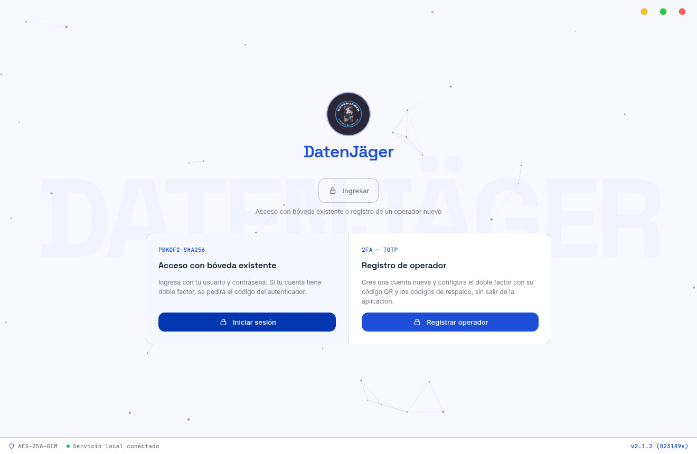

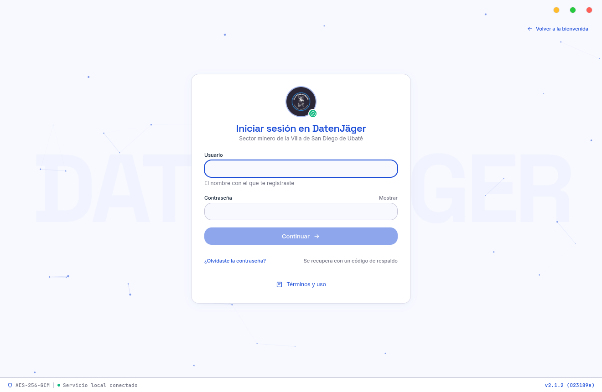

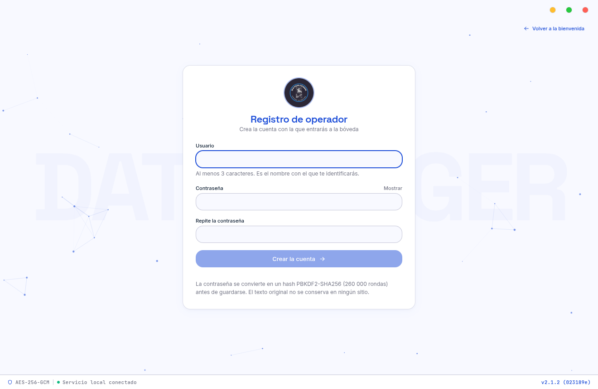

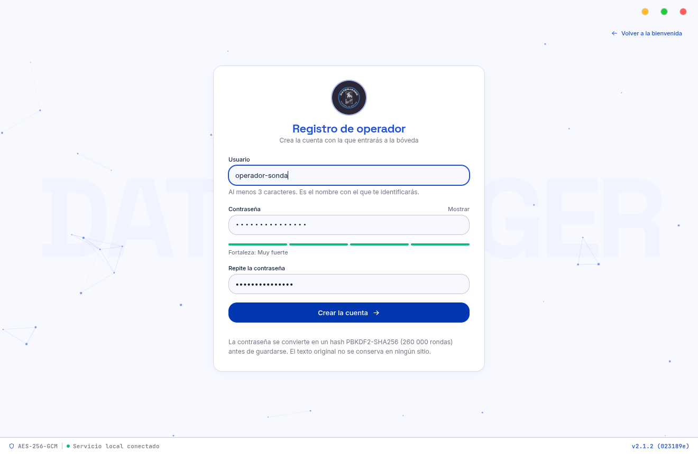

### Segundo factor

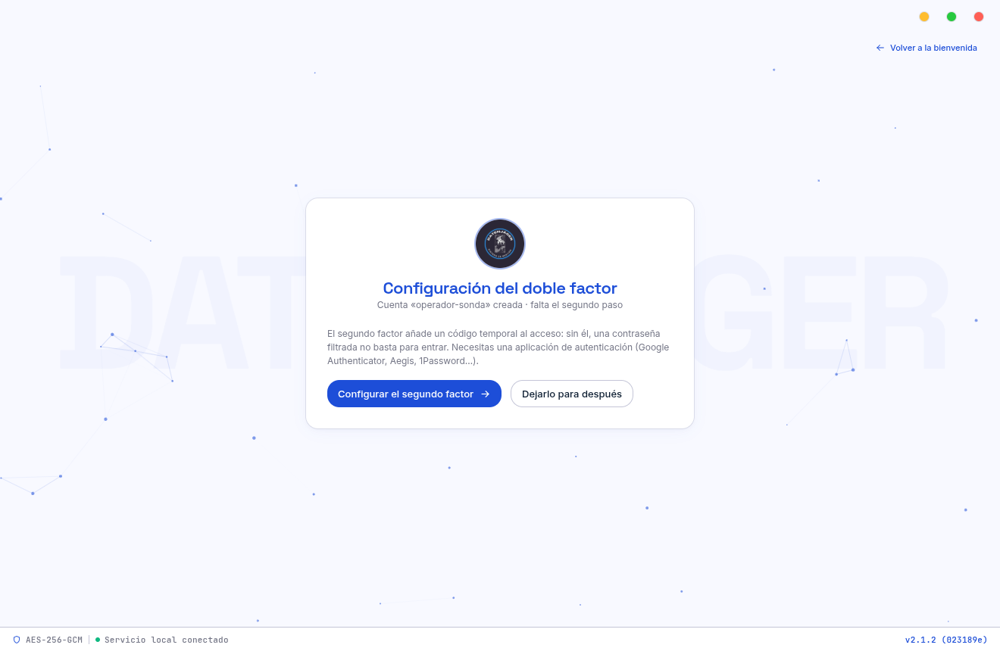

### Inicio y archivo documental

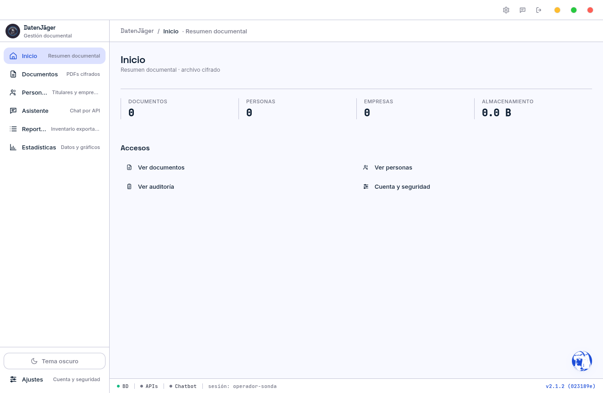

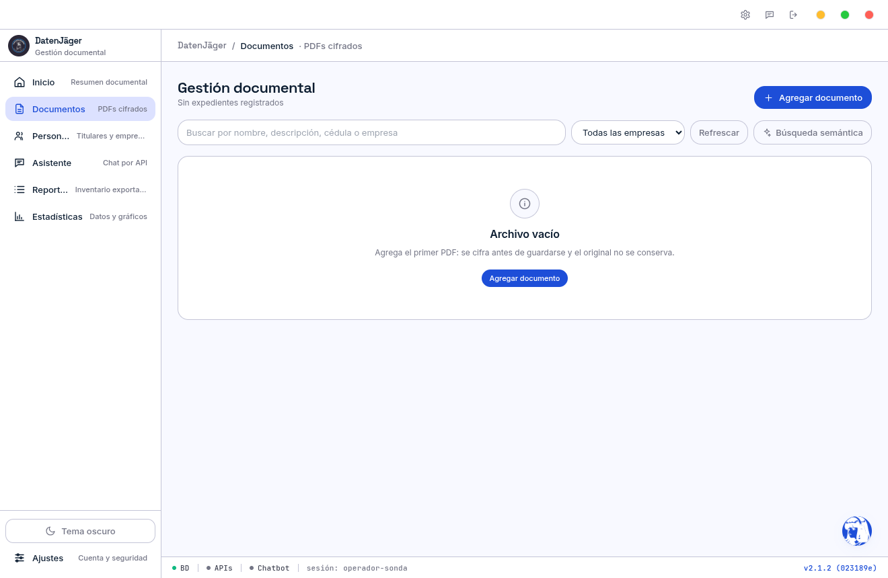

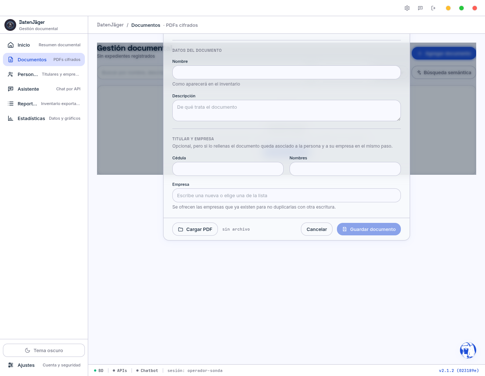

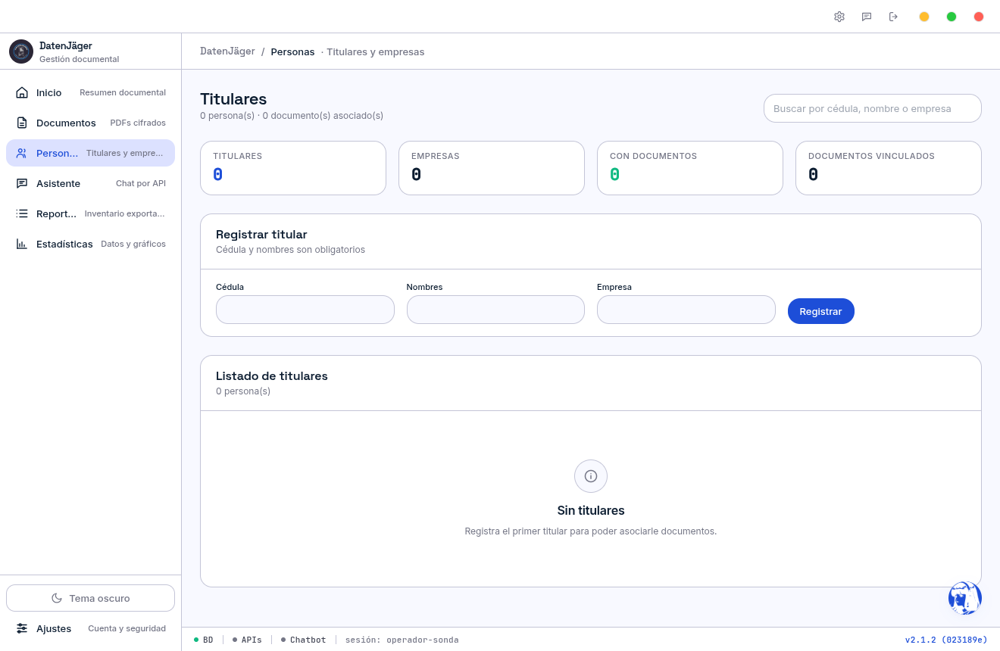

### Asistente

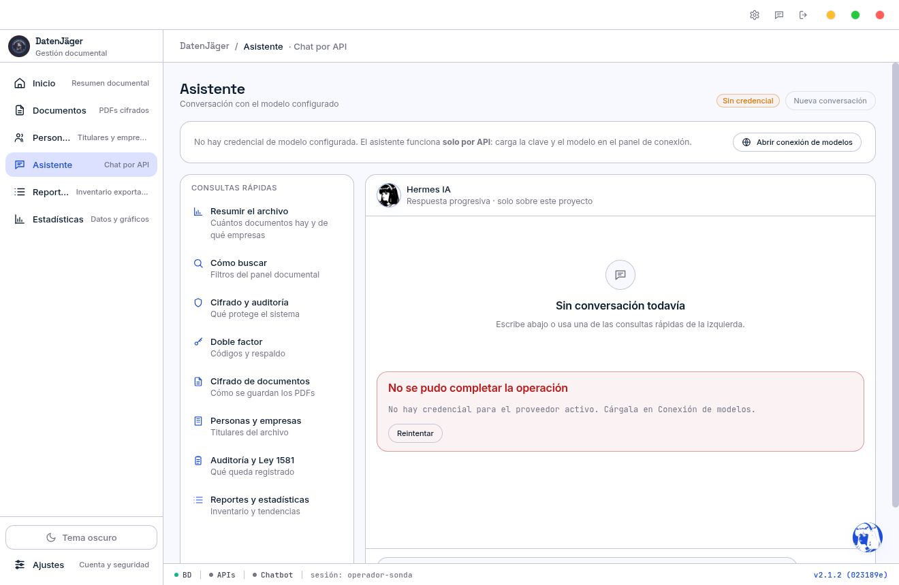

El aviso en esta captura es esperado: el perfil temporal no tiene credenciales de API. La conexión se configura desde Ajustes; no se enviaron consultas a un proveedor real para documentar la pantalla.

### Reportes, estadísticas y ajustes

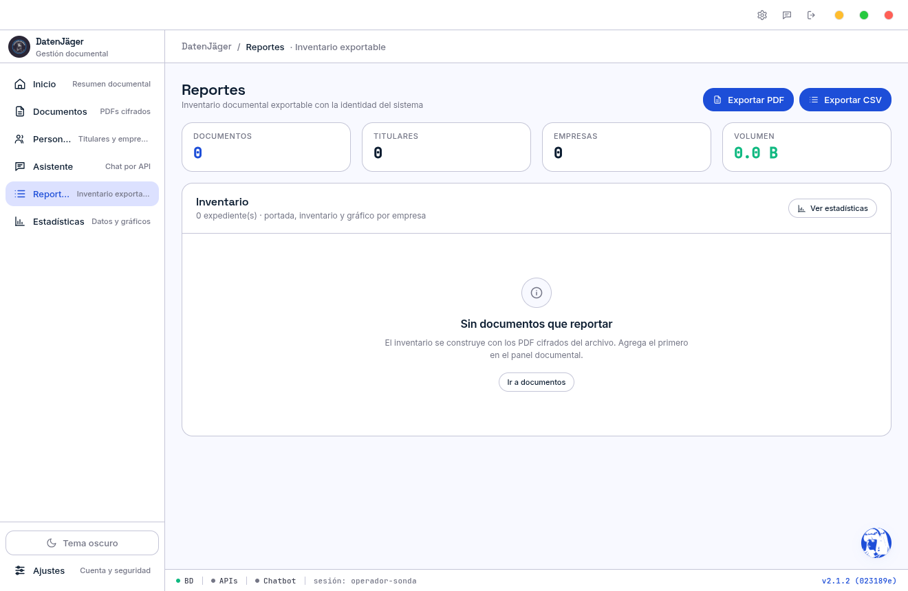

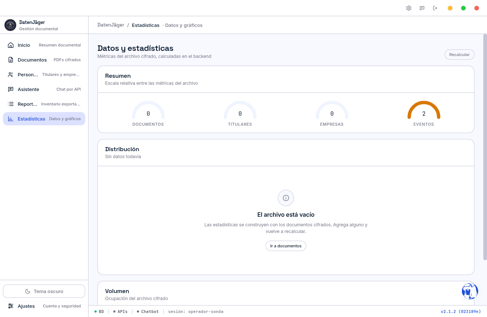

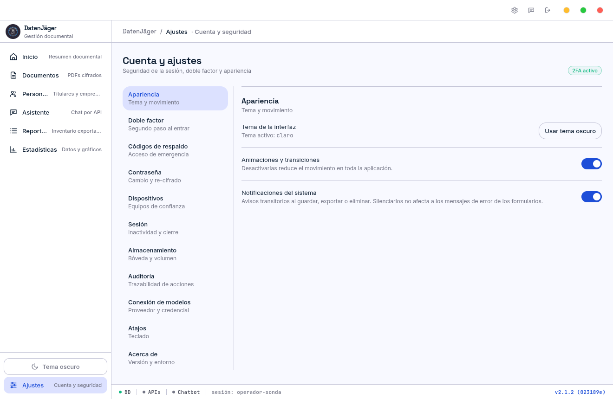

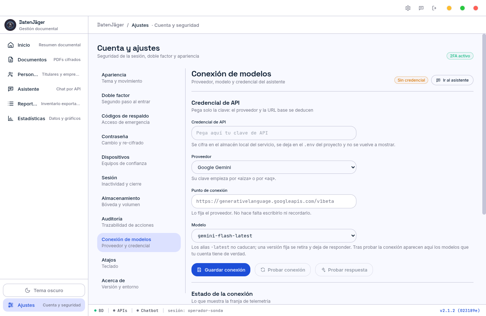

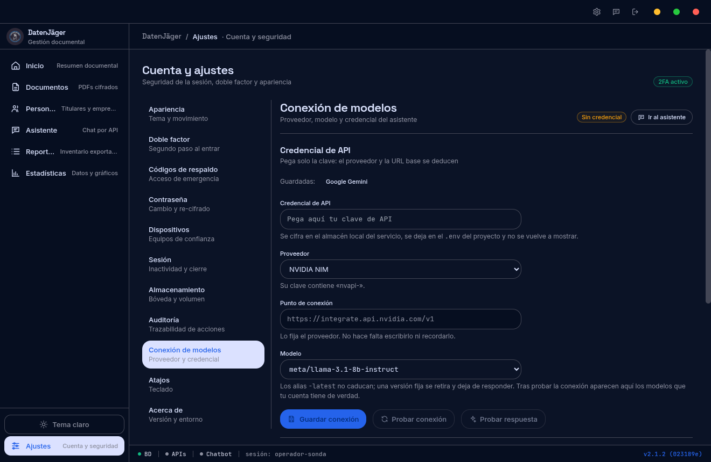

## Funciones y arquitectura

| Área | Implementación actual |
| --- | --- |
| Acceso | Registro de operador, contraseña, segundo factor TOTP, códigos de respaldo y ajustes de sesión. |
| Archivo | Alta de PDF con metadatos, búsqueda y filtros, asociación a titulares/empresas, visor interno, descarga y eliminación. |
| Seguimiento | Auditoría desde Ajustes, resumen inicial, estadísticas y exportación de reportes en CSV/PDF. |
| Asistente | Conversación por API con respuestas progresivas. Se configura desde Ajustes → Conexión de modelos. |
| Interfaz | Temas claro/oscuro, animaciones, notificaciones, barra lateral y atajos de teclado. |

```text
Electron (electron/main.js + preload.js)
  └─ React / Tailwind (src/)
       └─ HTTP local con token por proceso
            └─ FastAPI (backend/server.py)
                 └─ ComandosDatenJager → servicios Python
                      ├─ SQLite en modo WAL
                      ├─ cifrado y autenticación
                      └─ asistente y reportes
```

La lógica de negocio está en `backend/`; el frontend no accede directamente a SQLite ni recibe la clave de sesión de cifrado. `database.py`, `encryption.py` y otros módulos de la raíz aún sostienen el backend y la interfaz antigua hasta completar su retirada planificada. Véanse [backend/README.md](backend/README.md), [decisión de persistencia](docs/decision-persistencia.md) y [planning.md](planning.md) para el detalle técnico y el estado de fases.

## Instalación y desarrollo

### Aplicación instalable

Los instaladores publicados para Windows (`.exe`) y Linux (`.AppImage`) están en [GitHub Releases](https://github.com/RavenCore99/DatenJ-ger/releases). El backend viaja congelado dentro de la aplicación; **el usuario del instalador no necesita instalar Python ni Node.js**. Los datos de cada instalación —base, `.env` y almacenes— se crean localmente en el directorio de datos del usuario, no se distribuyen con el instalador. Consulta la página de cada release para saber qué versión contiene.

### Ejecutar el código fuente

Requisitos de desarrollo: Python 3.10 o posterior, Node.js compatible con `package.json`/Vite y npm. En la raíz del repositorio:

```bash
python -m venv venv
# Linux/macOS: source venv/bin/activate
# Windows: venv\Scripts\activate
python -m pip install -r requirements.txt
npm ci
npm run build
npm start
```

En Linux se puede activar el entorno con `source venv/bin/activate`. Para recarga en caliente usa `npm run dev` en lugar de `npm run build && npm start`. Electron busca `DATENJAGER_PYTHON` si se define, luego `venv` y, por último, `python3` del `PATH`. La interfaz anterior puede ejecutarse con `python main.py`, pero se mantiene solo durante la migración y no representa las capturas de este README.

El empaquetado local está preparado mediante `npm run dist:linux` y `npm run dist:win`; **no ejecutes el workflow de publicación ni crees una etiqueta de release** como parte de la instalación/desarrollo ordinario. `.github/workflows/release.yml` publica desde una etiqueta de versión o un despacho explícito, bajo control del responsable del proyecto.

## Primer uso

1. Abre la aplicación y elige **Ingresar → Registrar operador**.
2. Crea una contraseña y configura el segundo factor. Guarda los códigos de respaldo en un lugar seguro; no los publiques ni los incluyas en capturas.
3. En **Documentos**, agrega un PDF y sus metadatos; puedes vincularlo con un titular y una empresa en la misma operación.
4. Consulta **Inicio**, **Personas**, **Reportes** y **Estadísticas** desde la barra lateral. La auditoría y la conexión del asistente están en **Ajustes**.
5. Si vas a usar el asistente, guarda la credencial del proveedor en **Ajustes → Conexión de modelos** y usa **Probar conexión** y **Probar respuesta** antes de confiar en su disponibilidad.

Atajos principales: `Ctrl/⌘+F` búsqueda global; `Ctrl/⌘+N` alta de documento; `Ctrl/⌘+B` plegar barra; `F11` pantalla completa; `Ctrl/⌘+Q` cerrar sesión con confirmación; `Supr` eliminar un documento seleccionado (con confirmación). `Enter` envía un mensaje y `Mayús+Enter` añade una línea en el asistente.

## Seguridad y conexión de modelos

- Los PDF se cifran con AES-256-GCM; las contraseñas se almacenan como hashes PBKDF2-HMAC-SHA256. La autenticación admite TOTP y códigos de respaldo.
- La conexión del renderer al servidor local FastAPI utiliza un token generado por proceso. SQLite opera en modo WAL.
- El panel reconoce el proveedor cuando la forma de la clave lo permite; en caso contrario se selecciona manualmente. El catálogo incluye Gemini, NVIDIA NIM, OpenAI, OpenRouter y un endpoint compatible con OpenAI.
- Cada proveedor conserva **su propia credencial, modelo y endpoint**. Las claves se guardan cifradas en el almacén local y, para activarlas sin reiniciar, también en el `.env` local con permisos `0600`; **el `.env` contiene secretos en claro y nunca debe subirse al repositorio**. La respuesta del backend al panel informa el estado, no devuelve las claves.
- La franja de estado solo indica una conexión correcta tras una prueba real. Las capturas y pruebas automatizadas usan credenciales ficticias: **no certifican que una clave real de NVIDIA u otro servicio tenga acceso ni cuota**.
- El soporte de modelos locales mediante Ollama permanece aparcado por decisión del proyecto. La búsqueda semántica y clasificación forman parte de una evaluación; no se prometen como funciones definitivas.

## Pruebas y estado

```bash
./venv/bin/python -m unittest discover -s tests -t . -q
node --test tests/*.test.cjs
npm run build
```

La suite contiene **264 pruebas Python y 8 pruebas Node**. Los casos de modelos aíslan las credenciales exportadas o cargadas desde el `.env` local, sin usar claves reales; se verificaron tanto desde la raíz como desde un directorio temporal con una clave sintética de NVIDIA. Además se recorrió Electron compilado con datos aislados para generar y verificar las capturas; el build por sí solo no comprueba el DOM ni el flujo de acceso. El PR puede no tener checks automáticos de GitHub: el resultado local no equivale a una ejecución de CI. Los instaladores de una release anterior tampoco contienen automáticamente los cambios de `v2.1` que aún no se hayan integrado y publicado.

## Equipo y agradecimientos

| Integrante | Rol | Contacto |
| --- | --- | --- |
| Jorge Nicolás Castro Ballesteros | DevOps Leader | jncastro@ucundinamarca.edu.co |
| Yaderli Catalina Rodríguez Medina | DevOps Support | ycatalinarodriguez@ucundinamarca.edu.co |

Trabajo de grado de la **Universidad de Cundinamarca — Seccional Ubaté** (2026). Agradecemos las herramientas de **Nous Portal** que han apoyado el trabajo de diseño y desarrollo; esta mención no implica patrocinio ni aval institucional del software.

<div align="center">
  
</div>
